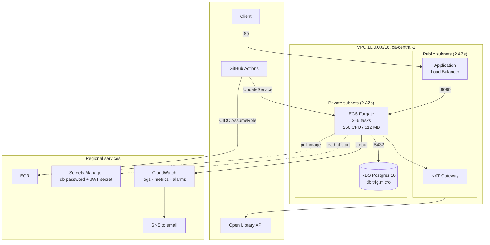

# Architecture

Everything below is provisioned by OpenTofu in `infra/envs/dev/`. No resource in
the path of a request was created by hand in the console.

## Topology



## Request path

A read of `GET /library` touches four things.

1. The ALB terminates the connection in a public subnet and forwards to a target
   in a private subnet. Its security group is the only one that accepts traffic
   from `0.0.0.0/0`.
2. The Fargate task validates the JWT locally, with no database round trip for
   auth, then borrows a connection from the asyncpg pool.
3. RDS answers from a private subnet. Its security group accepts traffic only
   from the app security group, referenced by ID rather than CIDR, so the rule
   survives subnet changes.
4. The response returns the same way. Nothing in the private subnets has a
   public IP.

`POST /library` adds a fifth hop. If the work is not already in `books`, the
task calls Open Library outbound through the NAT gateway, then upserts with
`ON CONFLICT`.

## Security group chain

Three groups, each referencing the previous one:

```
0.0.0.0/0 :80,:443  ->  alb-sg  ->  app-sg :8080  ->  db-sg :5432
```

No CIDR appears in an ingress rule after the ALB. That is why the stack can be
destroyed and rebuilt into different subnets without touching a rule.

## Deploy path

GitHub Actions holds no AWS credentials. The `deploy` job requests an OIDC token
from GitHub, exchanges it for a session on `booklog-dev-github-actions` via
`sts:AssumeRoleWithWebIdentity`, then:

```
build image -> push to ECR (tagged with the commit SHA)
            -> render task definition with the new image
            -> run migrations as a one-off Fargate task, assert exit code 0
            -> UpdateService, wait for stability
            -> smoke test the ALB
```

Migrations run as a separate task before the deploy rather than as a container
entrypoint. A failed migration fails the pipeline without having replaced any
running task.

## What is not here

**No HTTPS.** The listener is HTTP only. A certificate needs a domain, and a
domain outlives the stack, which gets destroyed between working sessions. This
is recorded rather than hidden.

**No multi-AZ RDS.** Single instance on `db.t4g.micro`. Subnets span two AZs so
the change is a one-line flag, but a standby in a dev environment is cost
without a corresponding risk.

**One NAT gateway** rather than one per AZ. See `decisions.md`.

## State

Remote state lives in S3 with a DynamoDB lock table, both in `us-east-1`, while
every workload resource is in `ca-central-1`. That split is intentional and
explained in `decisions.md`. The state infrastructure is the only part of this
project that must never be destroyed.
